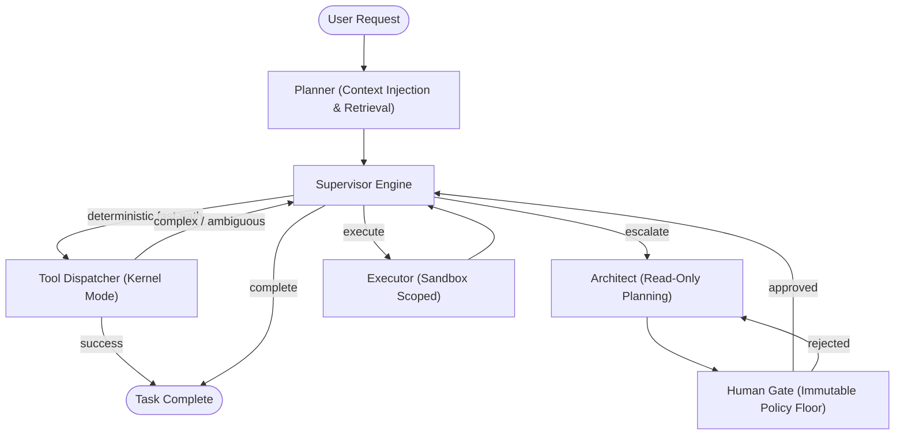

# AgentOS Runtime

[](https://github.com/simon-aibc/agentOS/actions/workflows/ci.yml)
[](LICENSE)

[](agent_os/api)

AgentOS Runtime is a self-hostable execution backbone for applications that use AI agents. It combines explicit tool dispatch, structured planning, approval gates, SQLite checkpoints, and extension contracts on LangGraph.

In the Hudos project, this is the reusable runtime layer. Hudos is the broader enterprise operating-system project; its business applications, user experience, company integrations, and deployment configuration are separate. This repository is not the complete Hudos product or a multi-tenant enterprise platform.

**Start here:** [Core source distribution and release scope](docs/public-release.md). The package metadata is `2.5.0rc1`, a release candidate for evaluation. See [RC notes](docs/releases/2.5.0rc1.md) and [support scope](SUPPORT.md). A local RC build does not mean the artifact has been published.

[Changelog](CHANGELOG.md) |
[Architecture](docs/architecture.md) |
[Extending Agent OS](docs/EXTENDING.md) |
[Self-Hosting](docs/self-hosting.md) |
[Product Spec](docs/PRD.md) |
[Roadmap](docs/roadmap.md)

---

## Table of Contents

1. [Core OS Primitives](#core-os-primitives)
2. [Everything is a Plugin](#everything-is-a-plugin)
3. [Built With](#built-with)
4. [Quickstart](#quickstart)
5. [Usage & Operating Modes](#usage--operating-modes)
6. [Self-Hosting & Operations](#self-hosting--operations)
7. [Extension Conformance Kit](#extension-conformance-kit)
8. [Security & Governance Invariants](#security--governance-invariants)
9. [Development & Contributing](#development--contributing)
10. [License](#license)
11. [Contact](#contact)
12. [Acknowledgments](#acknowledgments)

---

## Core OS Primitives

Agent OS organizes autonomous agent operations into distinct operating system subsystems:

- **Kernel / Deterministic Fast-Path**: Explicit supported tool commands can bypass LLM routing. Total execution still has tool, storage, and application overhead; this is not an end-to-end cost or latency benchmark.
- **Architect & Planning Subsystem**: Ambiguous or high-complexity tasks escalate to a read-only architect that produces structured execution proposals.
- **Governance & Policy**: Supported proposals pass policy evaluation and approval gates. Use supported enforcement modes; legacy policy-off configuration is not a production security boundary.
- **Workspace-Scoped Native Tools**: Native path checks and subprocess working directories reduce accidental cross-workspace access. They do not provide OS-level process or network isolation.
- **Memory & Retrieval Subsystem**: Multi-vault connectors (Markdown, G-Brain, SQLite, vectors) with cold-start indexing lifecycles (`IndexableMemory`) and non-blocking context injection (`ContextProvider`).
- **Persistence & Audit Subsystem**: SQLite state stores with live additive migrations, WAL-checkpoint backups, strategy assignment audit traces, and actor provenance (`Principal`).
- **IPC & Event Egress**: Real-time Server-Sent Events (SSE), local cron/interval scheduling, and DNS-rebinding-safe HMAC-signed webhooks (`EventSink`).



---

## Everything is a Plugin

Agent OS exposes a frozen, identity-preserving public facade under `agent_os.api` with 7 standard plugin entry-point groups:

| Plugin Group | Protocol / Contract | Description |
|---|---|---|
| `agent_os.connectors` | `Connector` | Custom action tools, CLI integrations, and external API connectors |
| `agent_os.memory_connectors` | `MemoryConnector`, `WritableMemory`, `IndexableMemory` | Long-term memory vaults, knowledge bases, and vector storage |
| `agent_os.backends` | `BackendAdapter` | Model execution backends (Claude Code, Codex CLI, LiteLLM, Ollama) |
| `agent_os.policies` | `PolicyEngine` | Custom policy evaluators, role constraints, and governance rules |
| `agent_os.skill_packages` | `SkillPackageLoader` | Reusable skill bundles, domain workflows, and instruction sets |
| `agent_os.context_providers` | `ContextProvider` | Pre-planner retrieval hooks and dynamic context injection |
| `agent_os.event_sinks` | `EventSink` | Lifecycle run event egress, telemetry, and signed webhook sinks |

### Authoring an Agent OS Plugin

Third-party extensions build directly against `agent_os.api` without private internals:

```python
from typing import Any

from agent_os.api import (
    Connector,
    ExecutionResult,
)

class MyCustomConnector:
    name = "my_tool"

    def capabilities(self) -> dict[str, Any]:
        return {"actions": ["custom_action"]}

    def describe_side_effect(self, action: str) -> str:
        return "read"

    def invoke(self, action: str, args: dict[str, Any]) -> ExecutionResult:
        return ExecutionResult(status="completed", outputs={"status": "ok"})
```

---

## Built With

- [LangGraph](https://github.com/langchain-ai/langgraph) for graph execution,
  interrupts, and checkpointed workflows
- [LangChain](https://github.com/langchain-ai/langchain) and
  [LiteLLM](https://github.com/BerriAI/litellm) for model/provider boundaries
- [Pydantic](https://docs.pydantic.dev/) for structured contracts
- [FastAPI](https://fastapi.tiangolo.com/) for the runtime API
- SQLite for local checkpoints, run ledgers, schedules, and state
- Optional container reference files; the current preparation targets Core source installation

---

## Quickstart

### Prerequisites

- Python 3.11 or 3.12
- Git
- A fresh disposable workspace for the initial example; no production database or vault is required

### 1. Installation

```bash
git clone https://github.com/simon-aibc/agentOS.git
cd agentOS

python -m venv .venv
source .venv/bin/activate
pip install -e ".[dev,serve]"
```

### 2. Explicit Tool Dispatch

For an isolated first run, follow the [Core quickstart](docs/self-hosting.md). In an already configured disposable checkout, an explicit command is:

```bash
agent-os "read_file README.md" --thread-id quickstart --sandbox .
```

Illustrative output (format can vary):
```text
[THREAD] quickstart
[SUPERVISOR] -> tool_dispatcher
[TOOL] read_file({"path": "README.md"})
[RESULT] # AgentOS Runtime ...
```

### 3. Configure Model Roles

```bash
cp .env.example .env
```

Agent OS reads 3 decoupled roles:

```bash
LLM_ROUTER="<provider>/<router-model>"
LLM_ARCHITECT="<provider>/<planning-model>"
LLM_EXECUTOR="<provider>/<execution-model>"
# Replace placeholders with models supported by your selected provider.
```

Subscription CLIs are also supported out of the box:

```bash
LLM_ARCHITECT=cli/claude-code
LLM_EXECUTOR=cli/codex
```

---

## Usage & Operating Modes

### Architect Planning & Approval Gates

When tasks require file modifications, code creation, or complex workflows, Agent OS builds a formal proposal and waits for approval:

```bash
agent-os "add type annotations to math_util.py and run tests" \
  --thread-id type-check-task \
  --sandbox ./sandbox
```

At the approval prompt, choose `approved` (one-time), `session`, `always_approve` (learned rule), or `rejected: <reason>`.

Interrupted runs resume seamlessly from SQLite checkpoints:

```bash
agent-os --resume --thread-id type-check-task --sandbox ./sandbox
```

### Multi-Turn Chat, Sessions & Schedules

```bash
# Interactive multi-turn CLI session
agent-os chat --thread-id dev-session

# Inspect active sessions and audit trails
agent-os sessions list
agent-os sessions inspect dev-session

# Local cron and interval background schedules
agent-os schedule list
```

### Self-Update & Live Migrations

```bash
# Check latest updates against GitHub releases
agent-os update --check

# Upgrade runtime with pre-migration database backup and daemon restart
agent-os update --yes --reload
```

---

## Self-Hosting & Operations

The selected preparation path is the standalone Core CLI/API. See the
[isolated source quickstart](docs/self-hosting.md). The repository's historical
Compose stack also includes a separate Console; it is retained as reference,
not qualified as a release path by this preparation. Console is not required
by the Core extension contracts.

### Run Runtime Server Locally

```bash
agent-os serve --host 127.0.0.1 --port 4680
```

Core Runtime Endpoints:
- `GET /api/health` — Runtime health and update cache
- `POST /api/runs` — Trigger non-blocking asynchronous agent runs
- `GET /api/runs/{run_id}/events` — Server-Sent Events (SSE) stream for live execution logs
- `POST /api/runs/{run_id}/approve` — Submit gate decisions for suspended runs

---

## Extension Conformance Kit

Agent OS includes a lightweight testing kit under `agent_os.testing.conformance` to validate plugins in standalone CI:

```python
from agent_os.testing.conformance import (
    check_connector,
    check_memory_connector,
    check_context_provider,
    check_event_sink,
)

def test_custom_plugin_conformance():
    sink = MyCustomEventSink()
    check_event_sink(sink)
```

Run the complete test suite:

```bash
pytest -q
```

---

## Security & Governance Invariants

- **Policy Composition**: The composite policy blocks `payment` and `privileged` actions before consulting plugins. Standalone legacy `LocalPolicy(mode="off")` disables enforcement and is outside the supported deployment envelope.
- **Anti-SSRF DNS-Rebinding Protection**: Webhooks validate target IPs against loopback/private CIDRs, pin sockets to verified IPs, and preserve TLS SNI/certificate validation.
- **Server-Trusted Actor Identity**: `Principal` provenance is resolved server-side. It is audit provenance, not per-user login, RBAC, or tenant isolation.
- **Workspace Isolation**: Separate deployment paths and stores must be selected for separate trust domains; a workspace label is not a tenant authorization boundary.

### Deployment Trust Boundaries

Agent OS provides application-level controls, not complete isolation. Human
approval governs agent-planned executor work, but explicit Tier-1
`write_file` and `bash` requests remain direct user instructions. Native
writes and subprocesses resolve under `AGENT_OS_SANDBOX`; subprocesses use
argument arrays, `shell=False`, timeouts, redaction, and output caps.

Checkpoints can contain tasks, messages, plans, tool results, and file
content, so treat them as sensitive local data. CLI argument guards and
permission modes are defense-in-depth rather than an OS sandbox. Run
untrusted workloads in a container, microVM, or another isolation layer.
Never commit `.env`, checkpoints, sandboxes, provider credentials, private
vault content, or real workflow logs.

---

## Development & Contributing

- [CONTRIBUTING.md](CONTRIBUTING.md) — Contributing guidelines and development workflow.
- [docs/EXTENDING.md](docs/EXTENDING.md) — Comprehensive guide to developing Agent OS plugins.
- [docs/architecture.md](docs/architecture.md) — Deep-dive system architecture.

---

## License

[MIT](LICENSE) © Simon Tran

---

## Contact

Simon Tran — [GitHub @simon-aibc](https://github.com/simon-aibc)

Project: [simon-aibc/agent-os-langgraph](https://github.com/simon-aibc/agentOS)

## Acknowledgments

- The README structure follows the community-friendly shape popularized by
  [Best-README-Template](https://github.com/othneildrew/Best-README-Template).
- LangGraph, LangChain, LiteLLM, FastAPI, Docker, Claude Code, and Codex
  provide ecosystem components that Agent OS integrates.
