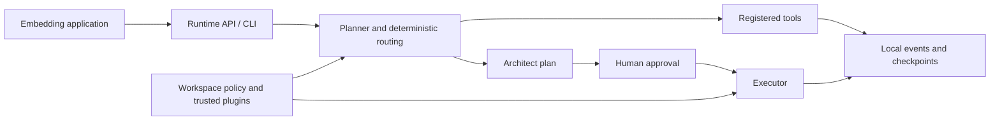

# Core source distribution and release scope

## Product boundary

AgentOS Runtime is the reusable execution layer for applications such as Hudos.
It offers graph routing, structured plans, approval/resume, local persistence,
and extension contracts. Hudos is the broader enterprise OS project combining
business applications, knowledge, people and agent-assisted execution. The Core
repository alone is not the full product or the full enterprise backend.

| Public Core candidate | Private application/deployment |
|---|---|
| Generic runtime and `agent_os.api` contracts | Company-specific workflows and integrations |
| Synthetic examples and extension tutorials | Personal vaults, customer records and proprietary prompts |
| Tests, architecture and known limitations | Runtime databases, credentials and raw operational evidence |
| Source/license/dependency declarations | Tenant authority, customer UI and deployment secrets |

Apply [ADR 0001](adr/0001-public-vs-private.md) to each proposed change.
A private application's working tree is not a release source. Select an exact
committed revision and list each additional reviewed file. Export only that
manifest, without Git history or local data. Useful generic work in a private
overlay can be extracted later with its own review; exclude it rather than
silently publish it or revert a working deployment.

## Supported preparation path

Use [standalone source installation](self-hosting.md). The existing package
version is metadata, not a new tag or release approval. Source includes example
workspaces and bundled skill directories; a wheel contains the Python package
and must not be presented as including every source-tree asset.

Historical Docker/Console configuration stays in the repository as reference.
It is not the selected distribution path and its image, token wiring, build
context and deployment contract need separate review before recommending it.
No Console rebuild or UI qualification is required to prepare Core source.

## Architecture, requests and authority

- A CLI caller executes with the local user's operating-system privileges.
  Explicit native write/subprocess commands are direct instructions; do not
  describe every such command as requiring a separate approval prompt.
- `server/api.py` checks private HTTP routes and the chat WebSocket. Configured
  execution tokens are checked even for loopback callers. Without a token,
  supported local mode trusts loopback callers; remote callers are denied.
  The health route is public. Allowed browser origins do not identify a user.
- `cli/app.py` refuses non-loopback serving without an execution token.
- `principal.py` provides server-resolved audit provenance. It is not OIDC, SSO,
  RBAC, or a complete authorization system. An embedding app must enforce its
  own user/company access before delegating work.
- `policy.py`, `nodes/human_gate.py` and the tool implementations enforce the
  supported proposal/approval and native-tool rules. Prompt instructions do not
  establish a security boundary. Third-party plugins are trusted executable code.
- `server/run_executor.py`, the run store and graph checkpoints persist different
  aspects of execution. Their state does not imply automatic crash recovery,
  distributed queue semantics, exactly-once effects, or tenant isolation.

## Configuration and secrets

All entries below belong to the runtime/deployment environment. This Core
candidate has no browser bundle. An embedding application must keep runtime
and provider secrets server-side; Core cannot certify downstream bundles.

| Setting | Consumer / purpose | Handling |
|---|---|---|
| `AGENT_OS_EXECUTION_TOKEN` | API / deployment caller gate; CLI remote bind | Secret; replace in server and clients together, restart deliberately |
| `AGENT_OS_PERMISSIONS_ADMIN_TOKEN` | Permission administration API | Separate secret when that surface is used; rotate affected clients |
| `AGENT_OS_CORS_ORIGINS` | API browser-origin allowlist | Public config; restrict to intended application origins |
| `AGENT_OS_WORKSPACE`, `AGENT_OS_SANDBOX` | Composition / native path scope | Paths, not tenant credentials; use separate roots for trust domains |
| `AGENT_OS_CHECKPOINTS_DB`, `AGENT_OS_SCHED_DB` | Checkpoints and schedules | Sensitive data locations; keep outside public source |
| `LLM_ROUTER`, `LLM_ARCHITECT`, `LLM_EXECUTOR` | Model or CLI backend selection | Non-secret identifiers; choose available models before using model-backed tasks |
| Provider API keys / CLI logins | Selected model backend | Deployment secret store; rotate at provider and update deployment |
| `AGENT_OS_SCHEDULER_ENABLED`, `AGENT_OS_SCHED_TICK_SECONDS` | Scheduler loop | Disable during isolated first run; code defaults enabled if absent |
| `MCP_FILESYSTEM_ENABLED`, `MCP_CODEGRAPH_ENABLED`, `MCP_GBRAIN_URL` | Optional tool/memory integrations | Enable deliberately; endpoints and credentials can expose private data |

`.env.example` is a template, not an instruction to load a real deployment's
`.env`. Workspace configuration can also supply bindings, plugins, memory and
webhooks; review it before execution. See `workspace.py`, `bindings.py`, `mcp.py`
and `webhooks.py`. Secret absence is not proof of zero egress.

## Agents and background automation

User-triggered work reaches deterministic tools or the architect/approval/
executor graph. Role prompts live in `agents/`; registered tool and connector
implementations define actual access. Results use the schema contracts and
validation in `schemas.py` and `validation.py`. Structured output validates
shape; it does not establish factual correctness or authorize a mutation.

The scheduler (`scheduler.py`, `schedules.py`) claims persisted cron/interval
occurrences and launches bounded in-process tasks. Ownership, schedule inputs
and target workspace must be reviewed by the operator. There is no distributed
lease/reclaim guarantee. Disable its loop to stop new scheduled dispatches.

Configured event sinks may emit lifecycle events. The webhook implementation
has a bounded delivery queue, URL validation and signing; queue saturation or
shutdown can affect delivery. Model backends, MCP tools, plugins, webhooks and
server update checks are distinct potential outbound paths. No universal
network kill switch or universal cost meter is claimed here.

## Verification map

These are existing source tests, not a statement that every row passed for a
particular candidate. Attach exact commands/results and interpreter/dependency
versions to the private release record.

| Rule / expected behavior | Existing evidence location | Coverage status |
|---|---|---|
| Public contracts and executable README connector example | `tests/test_public_api.py`, `test_public_api_conformance.py`, `test_docs_snippets.py` | Existing |
| Explicit commands parse and dispatch; ambiguous commands can escalate | `tests/test_default_registry.py`, `test_dispatcher.py` | Existing |
| Wrong token/origin rejected; out-of-root run rejected; remote bind needs token | `tests/test_api.py` | Existing |
| Native traversal rejected, supported policy/approval decisions applied | `tests/test_sandbox.py`, `test_policy.py`, `test_human_gate.py` | Existing |
| Checkpoints/run ledger survive documented operations | `tests/test_checkpoints.py`, `test_runs.py`, `test_checkpointer_cross_process.py` | Existing; not a distributed durability guarantee |
| Schedule lifecycle and webhook boundaries | `tests/test_scheduler.py`, `test_schedules.py`, `test_webhooks.py` | Existing; not universal egress coverage |
| Fresh packaged install on supported Python matrix, outside source | Release-specific install evidence | Required before release; local source tests do not substitute |
| Exact artifact privacy and license inventory | Manifest scan + maintainer review | Required before release; regex checks alone are incomplete |
| Native per-user/tenant authorization or universal traffic accounting | No such general guarantee | Not supported; do not advertise |

CI currently runs Ruff and pytest with warnings as errors on Python 3.11/3.12.
Contribution checks additionally include `pip check` and whitespace checks.
Targeted preparation checks are not a full CI or independent QA verdict.

## Publication gates

1. Bind candidate to exact revision, reviewed overlay and SHA-256 manifest;
   exclude private work, local state and Git history from the source export.
2. Scan the exact exported files and package contents. If publishing existing
   repository history, review that history separately; a clean export does not
   clear existing commits, branches, releases or remote artifacts.
3. Keep the MIT license and notices; inventory exact resolved dependencies and
   their licenses. Verify ownership and any redistribution obligations before
   publishing. A top-level MIT file does not license dependencies for you.
4. Validate packaged installation and synthetic usage on the declared Python
   matrix, with explicit authority/deny checks and documented limitations.
5. Verify a monitored private security-report channel, maintenance owner,
   supported scope, version/tag choice, and exact public repository destination.
6. Obtain the owner's decision for the exact release. Local preparation never
   publishes, pushes, changes repository visibility, or activates production.

See [known limitations](platform/known-limitations.md) for the deployment
contract. Performance and affordability remain hypotheses until measured on a
specified workload; do not use this preparation as a cost or latency benchmark.

## Repository and dependency checkpoint

The canonical public repository is [simon-aibc/agentOS](https://github.com/simon-aibc/agentOS).
The previous `agent-os-langgraph` repository URL redirects there; the Python
package/import names are unchanged. GitHub private vulnerability reporting was
observed enabled on 2026-10-18. Simon Tran is the owner-designated maintainer; support is best effort as
described in [SUPPORT.md](../SUPPORT.md).

See the [resolved dependency inventory](dependency-inventory.md) for the current
source preparation. Existing source examples still contain historical project
labels and synthetic secret fixtures; those labels do not include the private
application or its vault. The optional link-ingest skill can use a locally
configured cookie file and external retrieval/OCR executables. Its code and
synthetic tests are reference material, not an authorization to access private
accounts, a universal SSRF guarantee, or a customer-ready ingestion service.

## Current RC

Version `2.5.0rc1` is the owner-approved prerelease version for this preparation.
See [RC notes](releases/2.5.0rc1.md). Artifacts are rebuilt under that version;
old 2.4.0 review wheels must not be renamed or represented as this RC.
Publication, tag creation and deployment are separate from local preparation.
